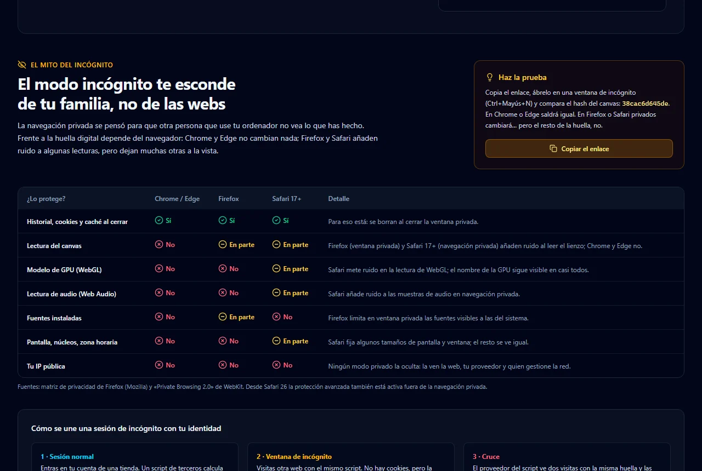
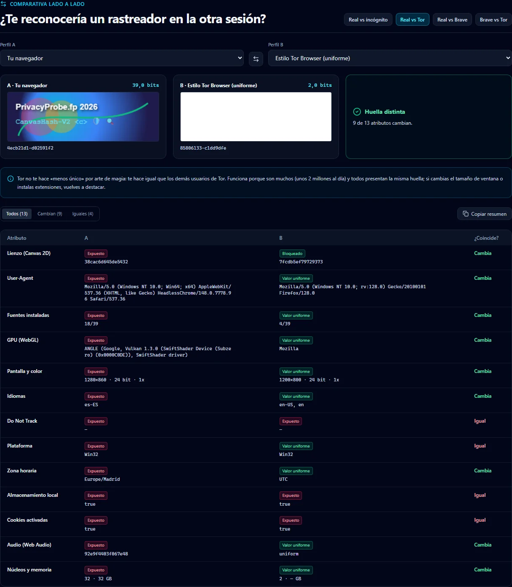
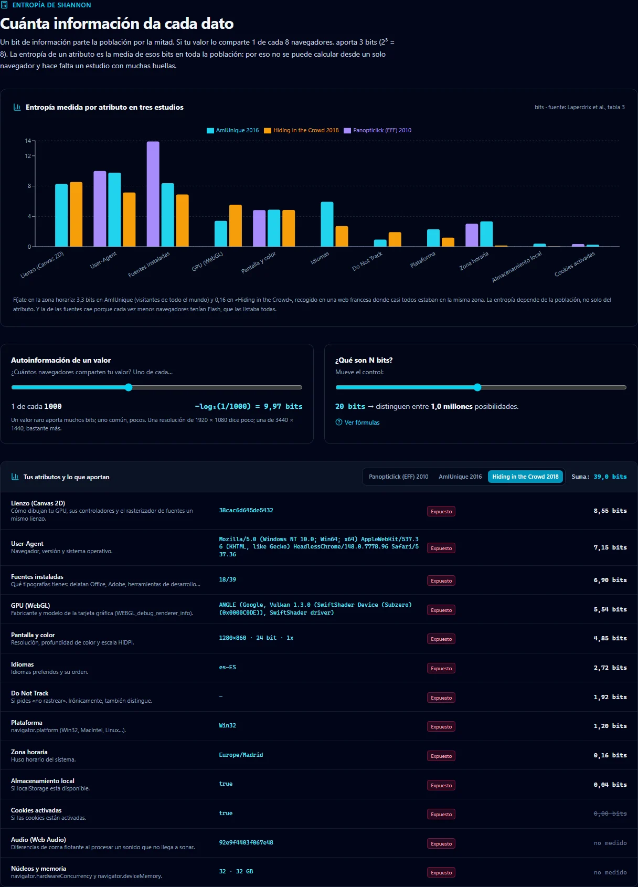

<p align="center">
  <a href="https://www.unfantasmaenelsistema.com"></a>
</p>

<h1 align="center">PrivacyProbe</h1>

<p align="center">
  <b>¿Hasta qué punto es único tu navegador?</b><br>
  Huella digital medida en tu navegador · Entropía con datos de estudios reales · Incógnito, Brave y Tor comparados · WebRTC
</p>

<p align="center">
  <a href="https://unfantasmaenelsistema.github.io/PrivacyProbe/"><b>▶ Abrir PrivacyProbe</b></a> ·
  <a href="#de-dónde-salen-los-bits">Los datos</a> ·
  <a href="#english">English</a> ·
  <a href="https://www.unfantasmaenelsistema.com">unfantasmaenelsistema.com</a> ·
  <a href="LICENSE">MIT</a>
</p>



Sin cookies y sin pedir permiso, cualquier web puede leer cómo dibuja tu tarjeta gráfica, qué fuentes tienes, tu pantalla, tu zona horaria o tu idioma. Juntos, esos datos forman una **huella** que puede seguirte de una web a otra, también en modo incógnito. PrivacyProbe te enseña la tuya, cuánta información aporta según estudios publicados y qué defensas funcionan de verdad.

> [!NOTE]
> Todo se calcula en tu navegador y nada se envía a ningún servidor. Solo hay dos conexiones externas, y únicamente si pulsas su botón: el servidor STUN de Google en la prueba de WebRTC y `api.ipify.org` si quieres comparar tu IP. No hay analítica, cookies ni fuentes de terceros (el flujo de despliegue lo comprueba).

## Qué hace

- **Lee tu huella real**: lienzo (Canvas 2D), GPU (WebGL), audio (Web Audio), 39 fuentes, pantalla, núcleos y memoria, User-Agent, idiomas, zona horaria, Do Not Track y Global Privacy Control.
- **Estima cuánta información expones** con la entropía medida en tres estudios a gran escala, que puedes alternar: Panopticlick (2010), AmIUnique (2016) e *Hiding in the Crowd* (2018).
- **Compara perfiles lado a lado**: tu navegador, incógnito, el ruido de Brave, la uniformidad de Tor o todas las defensas a la vez, con los dos lienzos y la tabla de atributos que cambian.
- **Laboratorio de 7 defensas**: ruido en canvas y audio, GPU oculta, letterboxing, fuentes empaquetadas, núcleos fijos, zona UTC y User-Agent común. Cada una muestra cuántos bits de referencia deja de exponer.
- **Prueba de WebRTC** que no da falsos positivos: distingue nombres mDNS, IP privadas, CGNAT e IPv6, y solo habla de fuga si la IP de STUN no coincide con la que ven las webs.
- **Material de clase**: el mito del incógnito por navegador, rastreo entre webs paso a paso, calculadora de autoinformación, 10 casos reales con su fuente y glosario.
- **Informe** en PDF, JSON o Markdown.
- Español e inglés, tema oscuro y claro, alto contraste, recorrido guiado y diseño para móvil.

<table>
  <tr>
    <td></td>
    <td></td>
  </tr>
  <tr>
    <td align="center"><sub>Tu navegador frente al perfil de Tor: el canvas sale en blanco y 9 de 13 atributos cambian.</sub></td>
    <td align="center"><sub>Entropía medida por atributo en los tres estudios y lo que aporta cada uno de los tuyos.</sub></td>
  </tr>
</table>

<sub>Capturas tomadas con Chrome sin interfaz, por eso la GPU aparece como SwiftShader.</sub>

## De dónde salen los bits

Un navegador **no puede calcular su propia entropía**: hace falta saber cómo se reparten los valores entre muchos navegadores. Por eso PrivacyProbe usa las cifras publicadas en la tabla 3 de [Laperdrix, Bielova, Baudry y Avoine, *Browser Fingerprinting: A survey*](https://arxiv.org/abs/1905.01051) (ACM TWEB, 2020):

| Atributo | Panopticlick 2010 | AmIUnique 2016 | Hiding in the Crowd 2018 |
| :-- | --: | --: | --: |
| Canvas | — | 8,278 | 8,546 |
| User-Agent | 10,000 | 9,779 | 7,150 |
| Fuentes | 13,900 | 8,379 | 6,904 |
| GPU (WebGL renderer) | — | 3,406 | 5,541 |
| Pantalla y color | 4,830 | 4,889 | 4,847 |
| Idiomas | — | 5,918 | 2,716 |
| Do Not Track | — | 0,944 | 1,919 |
| Plataforma | — | 2,310 | 1,200 |
| Zona horaria | 3,040 | 3,338 | 0,164 |
| Huellas analizadas | 470.161 | 118.934 | 2.067.942 |
| Únicas (escritorio) | 94,2 % | 89,4 % | 35,7 % |

Lo que la app hace con ellas, y lo que no:

- **La suma es una cota superior.** Sumar entropías supone que los atributos son independientes, y no lo son. El estudio de Google de 2024 ([Bacis et al.](https://arxiv.org/abs/2403.15607)), con datos de decenas de millones de Chrome, mide que la entropía conjunta es claramente menor.
- **No hay «1 entre billones».** Por encima de 32,9 bits la cuenta supera la población mundial; la app lo dice así en lugar de inventar cifras.
- **La entropía depende de la población.** Mira la zona horaria: 3,3 bits en AmIUnique (visitantes de todo el mundo) y 0,16 en *Hiding in the Crowd* (una web francesa).
- **Audio y núcleos/memoria** también distinguen, pero ningún estudio citado los midió: se muestran y no se suman.
- Los perfiles de Brave y Tor **no ejecutan esos navegadores**: aplican sobre tus datos el efecto documentado de cada defensa (ruido por sesión, valor uniforme o lectura bloqueada).

## Qué estaba mal en la versión anterior

La versión que generó AI Studio funcionaba y leía datos reales, pero presentaba cifras inventadas como si fueran mediciones:

- La entropía de cada atributo era **una constante escrita a mano** (canvas siempre 8,6 bits, GPU 7,8…) y luego se sumaba: salía «45,6 bits, 1 entre 53.329.535.657.309», miles de veces la población mundial.
- Las gráficas «Chrome estándar 35,8 bits», «Firefox RFP 21,6», «Tor 10,4» y la cascada de mitigaciones **no tenían fuente**; tampoco los «−7,4 bits» de cada defensa.
- En la comparativa, **el perfil de Tor tenía el mismo hash de canvas que tu navegador** mientras el texto decía «hashes divergentes».
- WebRTC solo reconocía como privadas `172.16.*` y `172.31.*` (una IP `172.20.x` salía como «pública filtrada») y marcaba como **fuga** la IP pública de STUN, que es la misma que ve cualquier web.
- Prometía «cero telemetría» pero **al abrir la página** consultaba el STUN de Google y cargaba las fuentes de Google Fonts.
- Decía que en incógnito la huella es «exactamente la misma» en todos los navegadores, pero Firefox y Safari ya meten ruido en algunas lecturas en modo privado.
- Errores de contenido: el acuerdo de *Brown contra Google* no fue de 5.000 M$ (Google no pagó daños), LibreWolf aparecía como navegador de «ruido», el laboratorio decía 7 defensas y tenía 6, y el pie ponía «Todos los derechos reservados» con licencia MIT.
- `bun.lock` no coincidía con `package.json`, jsPDF 2.5 tenía vulnerabilidades conocidas y los recursos usaban rutas absolutas que fallan en GitHub Pages.

## Desarrollo

Requiere [Bun](https://bun.sh).

```bash
bun install
```

```bash
bun run dev
```

```bash
bun run test
```

`bun run lint` comprueba los tipos y `bun run build` compila (con `GITHUB_PAGES=true` para la ruta `/PrivacyProbe/`). Las 24 pruebas cubren el modelo de entropía con las cifras publicadas, la clasificación de IP y candidatos ICE, los perfiles, los hashes con vectores de referencia y el texto del PDF. El flujo de GitHub Actions las ejecuta en cada PR y despliega en Pages al fusionar en `main`.

## English

**PrivacyProbe** shows your browser fingerprint (canvas, WebGL, audio, fonts, screen, hardware, User-Agent, languages, time zone), measured locally and never sent anywhere. Instead of made-up numbers, it estimates the information you expose using the per-attribute entropy measured by Panopticlick (2010), AmIUnique (2016) and *Hiding in the Crowd* (2018), and explains why the sum is only an upper bound. It compares incognito, Brave-style noise and Tor-style uniformity side by side, includes a 7-defence lab, an honest WebRTC test, real cases with sources and a glossary, and exports PDF/JSON/Markdown reports. Spanish and English, dark and light themes.

---

<p align="center">
  Hecho por <a href="https://www.unfantasmaenelsistema.com"><b>Un fantasma en el sistema</b></a> · <a href="https://ghostacademy.unfantasmaenelsistema.com">Ghost Academy</a> · Licencia <a href="LICENSE">MIT</a>
</p>
